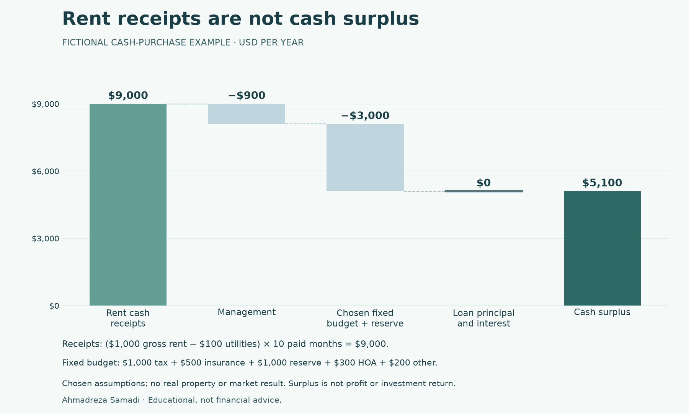

# Rent receipts are not cash surplus

A fictional teaching example by [Ahmadreza Samadi](https://a-samadi.com/about.html).
These are chosen numbers for a cash purchase, not an actual property, a metro result,
a quote, a market average or a forecast.

[Full figure alt text](budget-example-FICTIONAL.alt.txt) · [SVG figure](budget-example-FICTIONAL.svg) · [All chosen inputs and model outputs](budget-example-FICTIONAL.json)

## Follow the money

1. Start with a chosen gross monthly rent of USD 1,000. Subtract a chosen monthly utility deduction of USD 100. Multiply by ten paid months: **USD 9,000 annual cash receipts**. Do not apply another vacancy deduction to those receipts.
2. Deduct management at a chosen 10% of receipts: **USD 900**.
3. Deduct the chosen fixed annual budget: **USD 3,000**. A fictional USD 100,000 price and chosen fractions give USD 1,000 tax, USD 500 insurance and USD 1,000 maintenance reserve. Add USD 300 HOA and USD 200 other annual costs. Mortgage insurance is zero in this example.
4. Loan principal and interest are **USD 0**, because this is a cash purchase. The price is an upfront capital amount, not an annual deduction in this cash-budget model.
5. The remainder is **USD 5,100 annual cash surplus**: 9,000 − 900 − 3,000 − 0.

## What this still does not answer

The reserve is money earmarked for maintenance, not evidence that exactly that
amount was spent. A financed scenario would deduct principal and interest;
taxes and insurance must still be counted once. The model's loan payment
excludes escrow.

Cash surplus is not accounting profit, net operating income or total investment
return. This simple model excludes purchase/sale costs, appreciation, income tax,
initial repairs and the opportunity cost of the cash purchase. Read the
[full method and exclusions](../model-method.md) before adapting any case.

This arithmetic is already covered by the existing hand-calculated budget test
in [test_ownership_model.py](../test_ownership_model.py). It adds no observations
to the study and changes no model formula. The source code and this teaching
companion were prepared with AI assistance. Educational, not financial advice.

## Regenerate the figure

The normal study rebuild does not need a plotting package. For this optional
figure only, install Matplotlib, then run `python3 draw_budget_example.py` from
the repository root. The saved files were generated with Matplotlib 3.11.2.
The script calls the existing calculation model, checks the hand-calculated
amounts, and writes the PNG, SVG, full alt text and input/output JSON into `docs/`.
Rendering with another runtime or font environment may change image bytes.
